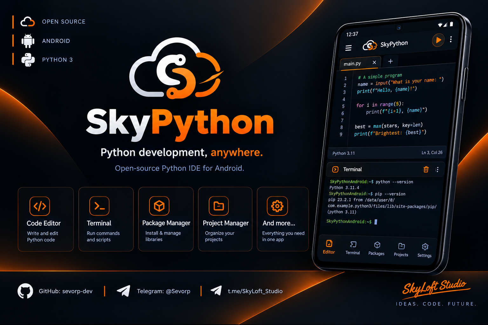
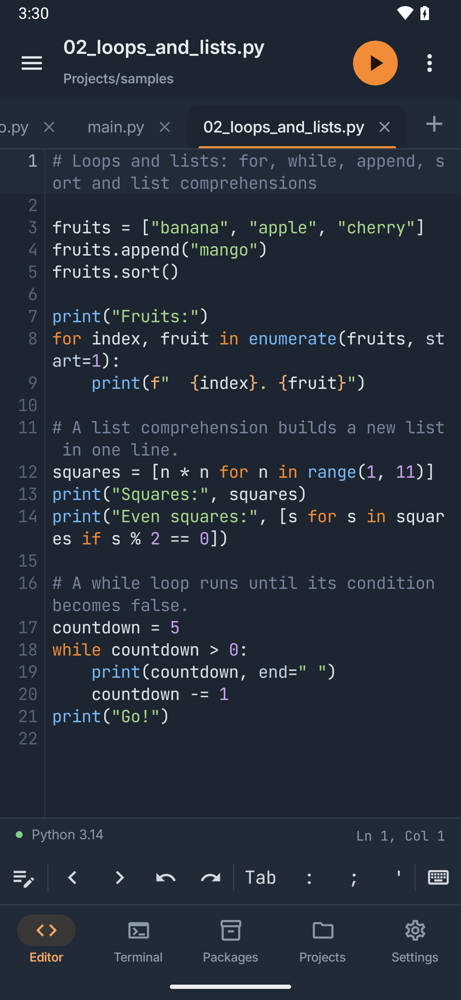
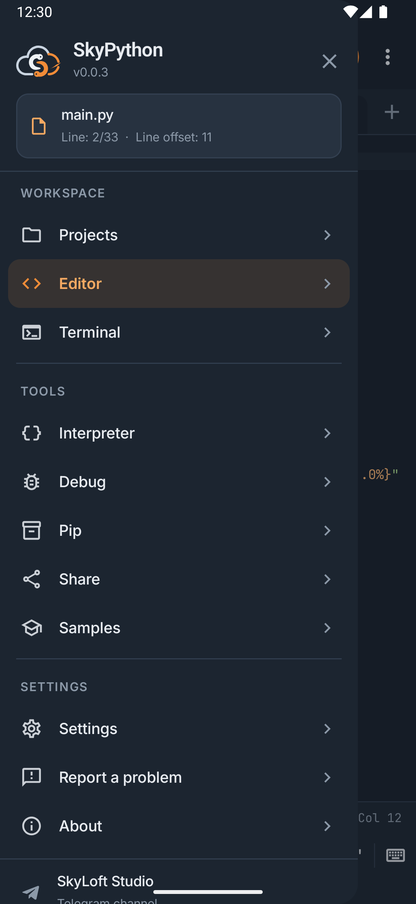
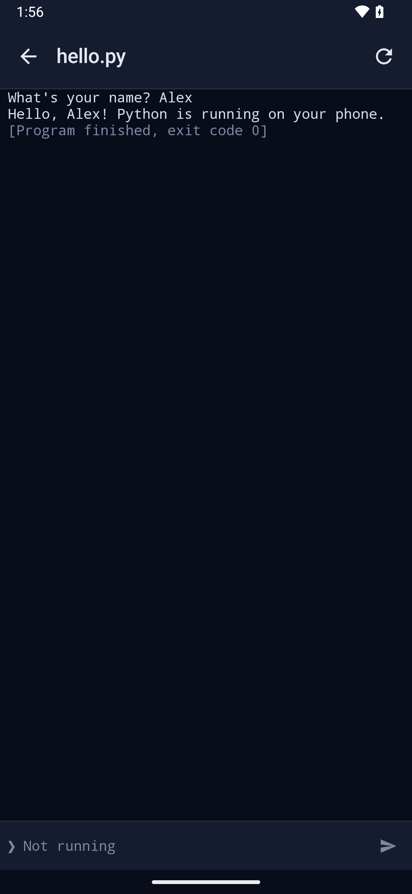
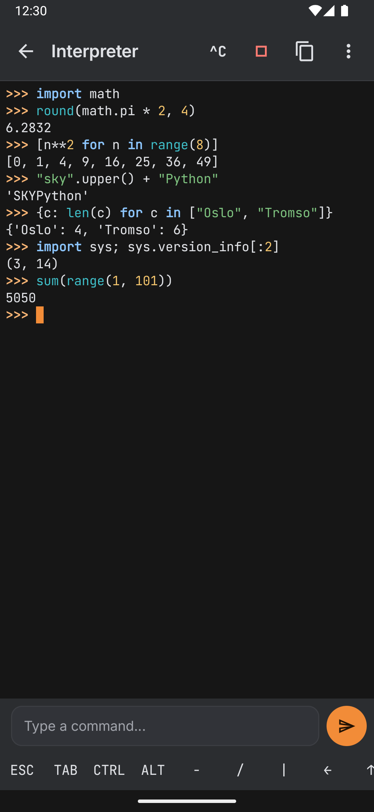
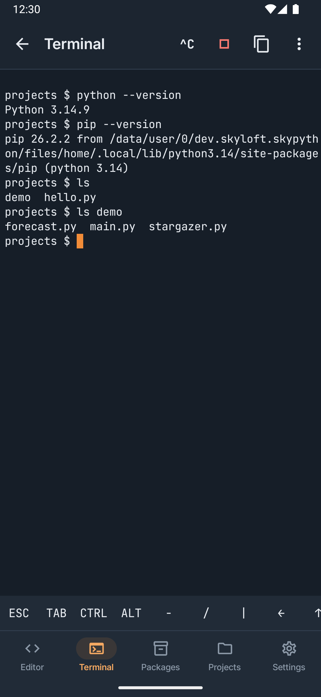
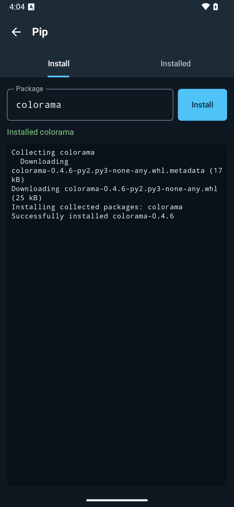
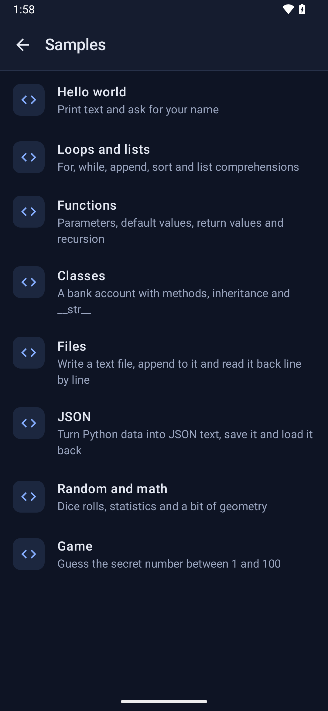
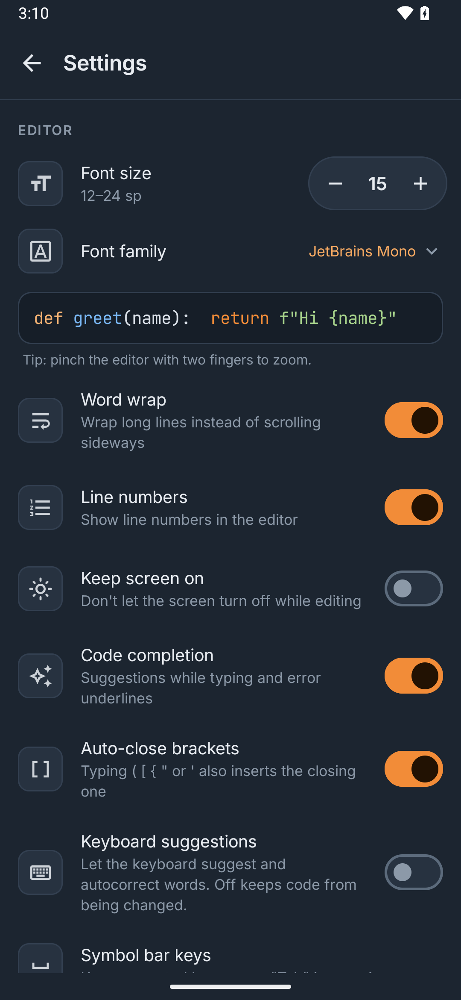

<div align="center">
  

  <h1>☁️ SkyPython</h1>

  <p><strong>Python development, anywhere.</strong></p>

  <p>
    A free, open-source Python 3 IDE for Android.<br>
    Write, run and debug Python right on your phone — fully offline.
  </p>

  <p>
    <a href="https://github.com/sevorp-dev/SkyPython/releases/latest"></a>
    
    
    <a href="LICENSE"></a>
  </p>

  <p>
    <a href="#-install">Install</a> ·
    <a href="#-features">Features</a> ·
    <a href="#-screenshots">Screenshots</a> ·
    <a href="#-build-from-source">Build</a> ·
    <a href="https://github.com/sevorp-dev/SkyPython/issues">Report a bug</a> ·
    <a href="https://t.me/SkyLoft_Studio">Telegram</a>
  </p>
</div>

---

## ✨ About

**SkyPython** turns an Android phone into a real Python workstation. It ships the official
**CPython 3.14** interpreter, so your code runs exactly like on a computer — no server, no
internet connection, no account.

Everything a mobile Python developer needs, in the open: a comfortable editor with a tool
drawer, an interactive console, a terminal and a package manager — free of ads and premium
walls, and built to work on as many phones as possible, including old and low-end ones.

## 🆕 What's new in 0.0.2

- 🌌 **Night-sky look** in the SkyPython colours, new app icon, round ▶ Run button
- ☰ **Tool drawer** with Interpreter, Terminal, Pip, Samples, Settings and more
- 📱 **Android 7.0+ and 32-bit phones**, ~14 MB download

Full details for every version: [CHANGELOG.md](CHANGELOG.md).

## 🚀 Features

| | |
|---|---|
| 📝 **Code editor** | Python syntax highlighting, line numbers, word wrap, tabs for several files (`*` marks unsaved ones), undo/redo and a symbol bar with `Tab : ; ' " # ( ) [ ] { } = …` above the keyboard. |
| ▶️ **Run** | One tap on the yellow ▶ runs the current file. Each run is a separate process, so **Stop** always works and a crashing script can't take the app down. |
| 💻 **Console** | `print()` and `input()` just work; errors are shown in red with the exit code. |
| 🐍 **Interpreter** | An interactive Python shell (`>>>`) for quick experiments. |
| ⌨️ **Terminal** | A basic shell with `python` and `pip` commands. |
| 📦 **Pip** | Install, list and remove pure-Python packages from PyPI (`requests`, `rich`, `six`, …). |
| 📁 **Files** | Projects folder with create / rename / delete; open and save files from other apps. |
| 🎓 **Samples** | Ready-to-run examples: input, loops, functions, classes, files, JSON, a small game. |
| ⚙️ **Settings** | Font size, word wrap, line numbers, keep screen on. |
| 🔗 **Share** | Send the current script to any app. |
| 🌌 **Night-sky theme** | Deep navy, electric blue and violet — easy on the eyes, day and night. |

Everything works **offline** except installing packages with pip.

## 📱 Screenshots

<p align="center">
  
  
  
  
</p>
<p align="center">
  
  
  
  
</p>

## 📥 Install

Download **one** APK from the [latest release](https://github.com/sevorp-dev/SkyPython/releases/latest)
and open it on your phone (allow *Install unknown apps* for your browser or file manager when asked).

| Your phone | File to pick | Size |
|---|---|---|
| Most phones (2017 and newer) | `SkyPython-<version>-arm64-v8a.apk` | ~14 MB |
| Old 32-bit phones | `SkyPython-<version>-armeabi-v7a.apk` | ~14 MB |
| Not sure | `SkyPython-<version>-universal.apk` — works everywhere | ~25 MB |
| Emulators, x86 Chromebooks | `SkyPython-<version>-x86_64.apk` (`-x86.apk` for 32-bit) | ~14 MB |

If Android says *"App not installed"*, you picked the wrong one — take `universal`.
`SHA256SUMS` in the release lets you verify the download. New versions install over old ones.

### Supported devices

- **Android 7.0 (API 24) and newer** — every version is tested automatically on emulators (Android 7, 9, 11, 14, 16).
- **64-bit ARM** (almost all phones since 2017), **32-bit ARM** (older and budget phones) and **x86 / x86_64** (emulators, Chromebooks).
- Needs about **60 MB** of free storage (the app plus Python unpacked on first run). The first Run takes a few seconds while Python is prepared; after that it starts instantly.

## 🧠 How it works

```
┌──────────────── SkyPython app (Kotlin, Jetpack Compose) ────────────────┐
│  Editor ─ Files ─ Samples ─ Settings ─ Pip ─ Console / Interpreter / Terminal │
└───────────────────────────────┬──────────────────────────────────────────┘
                                │ starts a child process, pipes stdin/stdout/stderr
                ┌───────────────▼────────────────┐
                │  libpylauncher.so (tiny C)     │  → Py_BytesMain()
                │  libpython3.14.so + stdlib     │  official CPython for Android
                │  ~/.local (pip --user packages)│
                └────────────────────────────────┘
```

- **CPython** comes from python.org's [official Android build](https://docs.python.org/3/using/android.html) (64-bit) and from our own [build workflow](.github/workflows/build-python.yml) that runs CPython's `Android/android.py` (32-bit).
- The **standard library** is packed per CPU type and unpacked once into the app's private storage.
- Each program runs as a **separate process**, exactly like on a desktop computer.
- The **editor** is [Sora Editor](https://github.com/Rosemoe/sora-editor) with TextMate grammars (MagicPython).

## 🛠️ Build from source

1. Install [Android Studio](https://developer.android.com/studio) (bundles JDK 21) with Android SDK 36, NDK `28.2.13676358` and CMake `3.22.1` (*SDK Manager → SDK Tools*).
2. Clone and open the project:
   ```sh
   git clone https://github.com/sevorp-dev/SkyPython.git
   ```
3. Press **Run ▶** in Android Studio, or build from the command line:
   ```sh
   ./gradlew assembleDebug                                 # debug APK, all CPU types
   ./gradlew assembleRelease -Pskypython.abis=arm64-v8a    # small release APK for one CPU type
   ```

The first build downloads CPython for Android (~23 MB per CPU type), checks it against
SHA-256 hashes pinned in [`runtime/python.properties`](runtime/python.properties) and packs it
into the APK. Nothing Python-related is stored in git. Which CPU types are built is set by
`skypython.abis` in [`gradle.properties`](gradle.properties).

<details>
<summary><b>Building Python for 32-bit devices</b></summary>

python.org publishes CPython for Android only for 64-bit devices (arm64-v8a, x86_64). For older
32-bit phones (armeabi-v7a) and x86 emulators, SkyPython builds the same CPython version itself
with CPython's own `Android/android.py`:

1. Run the **Build Python for Android (32-bit)** workflow (*Actions → Run workflow*, or push the
   `build-python` branch). It takes 30–60 minutes and stores the two tarballs in the
   [`cpython-builds`](https://github.com/sevorp-dev/SkyPython/tree/cpython-builds) branch.
2. Copy the two `sha256.…=…` lines from the run summary into `runtime/python.properties`.
3. List the ABIs in `gradle.properties`: `skypython.abis=arm64-v8a,armeabi-v7a,x86,x86_64`.

The build stops with an explanation if a 32-bit ABI is enabled before its hash is pinned.
Don't re-run the workflow for an already published version: builds aren't byte-identical, so
pinned hashes would stop matching (the workflow refuses unless you tick `replace`).
</details>

### Tests

```sh
./gradlew testDebugUnitTest            # JVM unit tests
./gradlew connectedDebugAndroidTest    # on a device or emulator: runs real Python
```

CI ([`android.yml`](.github/workflows/android.yml)) builds every push and runs the device tests
on Android 7, 9, 11, 14 and 16. Pushing a `v*.*.*` tag publishes a release
([`release.yml`](.github/workflows/release.yml)).

### Project layout

| Path | What's inside |
|---|---|
| `app/` | The Android app: editor, console, files, pip, samples, settings (Jetpack Compose) |
| `runtime/` | Python runtime: CPython download & packaging, installer, process runner, NDK launcher |
| `buildSrc/` | Shared build logic (CPU types ↔ CPython builds) |
| `.github/workflows/` | CI, releases, 32-bit CPython builds |

## 📜 Changelog

What's new in every version: [CHANGELOG.md](CHANGELOG.md) and the [Releases](https://github.com/sevorp-dev/SkyPython/releases) page.

## 🗺️ Roadmap

- [x] Code editor with syntax highlighting
- [x] Run scripts offline with CPython 3.14
- [x] Interactive console, interpreter and terminal
- [x] Pip for pure-Python packages
- [x] Tool drawer, samples, settings
- [x] Android 7.0+ and 32-bit devices
- [ ] Full terminal emulator (colors, `Ctrl+C`, curses)
- [ ] Code completion and error hints
- [ ] Prebuilt packages with native code (NumPy, Pillow, …)
- [ ] GUI apps (Kivy / Tkinter-style)
- [ ] Light theme and more languages

## 🤝 Contributing

Bug reports, ideas and pull requests are welcome!

- Found a bug? [Open an issue](https://github.com/sevorp-dev/SkyPython/issues) with your Android version and phone model.
- Want a feature? Tell us in [Issues](https://github.com/sevorp-dev/SkyPython/issues) or on [Telegram](https://t.me/SkyLoft_Studio).
- Sending code? Please open an issue first for bigger changes, and run `./gradlew testDebugUnitTest` before the PR.

## 👨‍💻 Author

Developed by **[Sevorp](https://github.com/sevorp-dev)** · **SkyLoft Studio 🌥**

- Telegram: [@SkyLoft_Studio](https://t.me/SkyLoft_Studio)
- GitHub: [sevorp-dev](https://github.com/sevorp-dev)

## 📄 License

SkyPython is licensed under the [Apache License 2.0](LICENSE).

It bundles: **CPython** (PSF License), **Sora Editor** (LGPL-2.1), **MagicPython grammar** and
**VS Code theme data** (MIT) — see [`NOTICE.md`](app/src/main/assets/textmate/NOTICE.md).
SkyPython is an independent project and is not affiliated with the Python Software Foundation.

---

<div align="center">
  <strong>SkyPython</strong> — Python development, anywhere. ☁️<br>
  <sub>Made with ❤️ by SkyLoft Studio</sub>
</div>
