<div align="center">
  

  <h1>☁️ SkyPython</h1>

  <p><strong>Python development, anywhere.</strong></p>

  <p>
    A free, open-source Python 3 IDE for Android.<br>
    Write, run and debug Python right on your phone — fully offline.
  </p>

  <p>
    <a href="https://github.com/sevorp-dev/SkyPython/releases/latest"></a>
    
    
    <a href="LICENSE"></a>
  </p>

  <p>
    <a href="#-install">Install</a> ·
    <a href="#-features">Features</a> ·
    <a href="#-screenshots">Screenshots</a> ·
    <a href="#-build-from-source">Build</a> ·
    <a href="https://github.com/sevorp-dev/SkyPython/issues">Report a bug</a> ·
    <a href="https://t.me/SkyLoft_Studio">Telegram</a>
  </p>
</div>

---

## ✨ About

**SkyPython** turns an Android phone into a real Python workstation. It ships the official
**CPython 3.14** interpreter, so your code runs exactly like on a computer — no server, no
internet connection, no account.

Everything a mobile Python developer needs, in the open: a comfortable editor with a tool
drawer, an interactive console, a terminal and a package manager — free of ads and premium
walls, and built to work on as many phones as possible, including old and low-end ones.

## 🆕 What's new in 0.0.4

- 🔢 **NumPy on your phone** — Pip installs **NumPy 2.5** prebuilt for Android in one tap, no compiler needed. Packages built by SkyPython carry a **"Prebuilt for Android"** badge
- 🌑 **IDE dark theme** — near-black editor and terminal like desktop IDEs, neutral greys, the same orange accent and retuned syntax colours
- 🖼️ **Image viewer** — pictures your script saves show up as chips under the finished run; open them with pinch and double-tap zoom, share or delete. PNG, JPEG, GIF, WebP and BMP files open from Projects too
- 🎨 New sample **"Draw a picture"** — a Mandelbrot fractal drawn with the standard library only
- 🛠️ Fixes: the debugger could crash the app when it closed at the wrong moment; Pip re-reads the package list if it changed while you were offline

0.0.3 brought the real terminal, the smart editor, the debugger, PyPI search and the Russian interface.

Full details for every version: [CHANGELOG.md](CHANGELOG.md).

## 💸 Free. Really.

No ads, no premium tier, no account, no tracking. Code completion, live error checking, the
debugger, the full keyboard bar and everything else that other mobile IDEs sell as "premium"
is simply part of SkyPython.

## 🚀 Features

| | |
|---|---|
| 📝 **Editor** | Python highlighting, tabs with ✕ and `+`, line numbers, word wrap, pinch-to-zoom, undo/redo, auto-indent, auto-closing brackets and quotes, a customizable symbol bar, keyboard without autocorrect (no more "Print" instead of `print`). |
| 💡 **Code intelligence** | Completion while typing, live error and warning underlines, **go to definition** (also into the standard library, read-only), usages, **outline** of classes and functions, **parameter hints** inside calls. Works offline. |
| 🔎 **Editing tools** | Find & replace (match case, whole word, regex), go to line, comment/uncomment, indent/outdent, duplicate, move or delete lines, recent files, hardware-keyboard shortcuts (Ctrl+S, Ctrl+F, Ctrl+/, F5…). |
| ▶️ **Run** | One tap on the orange ▶ runs the file in a real terminal: colours, `input()` with line editing, `
` progress bars. **^C** sends KeyboardInterrupt, **Stop** always works. When it ends: Copy all, Share, Save output, Run again. Tap `File "…", line N` in a traceback to open that line. |
| 🐞 **Debugger** | Tap a line number to set a breakpoint (long-press for a condition), long-press ▶ → Debug. Step over / into / out, continue, variables tree, watches, call stack. |
| 🐍 **Interpreter** | Interactive Python (`>>>`) with history, colours and Ctrl+C that interrupts without losing your session. |
| ⌨️ **Terminal** | A real terminal with `python`, `pip`, Esc / Tab / Ctrl / Alt / arrows. |
| 📦 **Pip** | Search PyPI, popular packages in one tap, install from `requirements.txt`, updates and uninstall. Pure-Python packages from PyPI, plus packages with native code that SkyPython builds for Android — **NumPy** today, more coming. |
| 🖼️ **Images** | Pictures your program saves appear right under the run output; a built-in viewer with zoom, share, open with and delete. |
| 📁 **Projects** | Create, rename, delete files and folders; open and save files from other apps; **share** a file as is or a whole folder as `.zip` (Telegram, mail, cloud…). |
| 🎓 **Samples** | Ready-to-run examples with search: input, loops, functions, classes, files, JSON, a small game, drawing a picture. |
| ⚙️ **Settings** | Font size and family, word wrap, line numbers, completion, auto-close, keyboard suggestions, symbol bar keys, terminal size and theme, bottom bar on/off, language (English / Русский). |
| 🚨 **Report a problem** | If something goes wrong, SkyPython offers to send a report (error + device info, no personal data) as a GitHub issue or via any app — nothing is ever sent automatically. |

Everything works **offline** except installing packages with pip.

## 📱 Screenshots

<p align="center">
  
  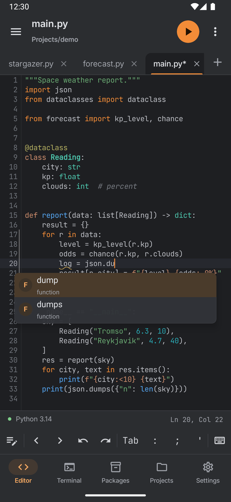
  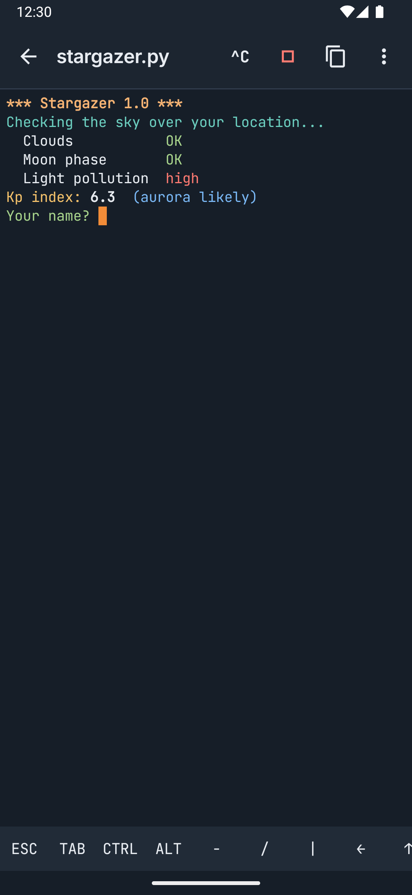
  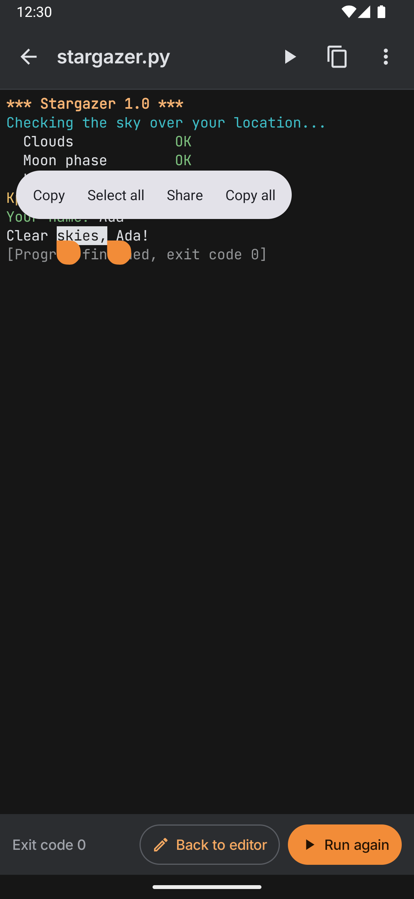
</p>
<p align="center">
  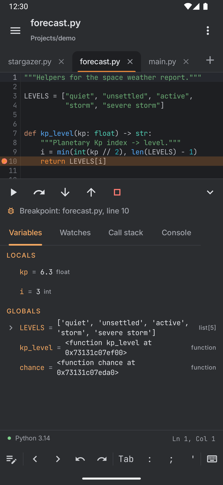
  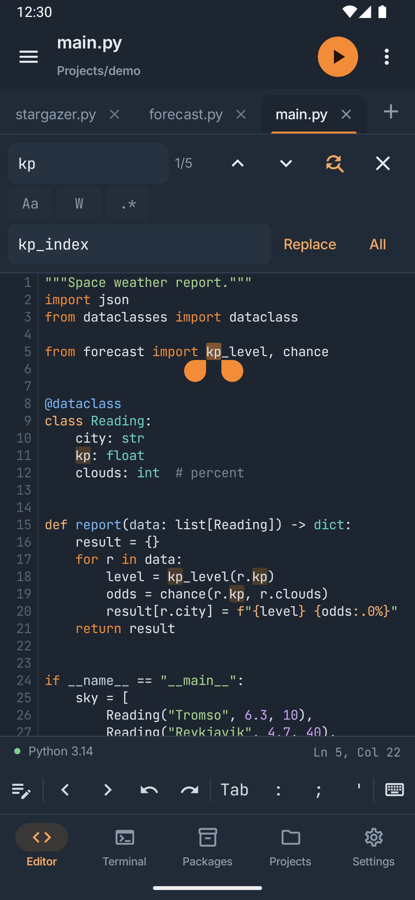
  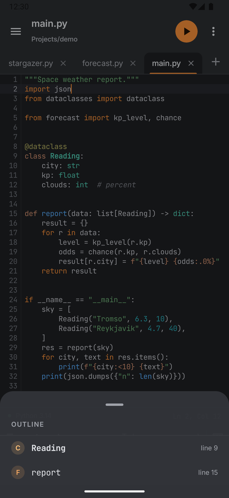
  
</p>
<p align="center">
  
  
  
  
</p>
<p align="center">
  
  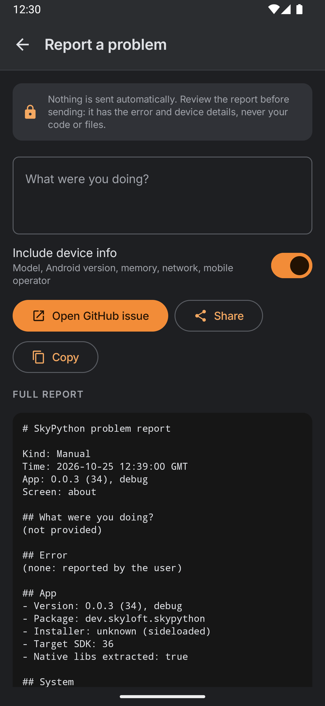
  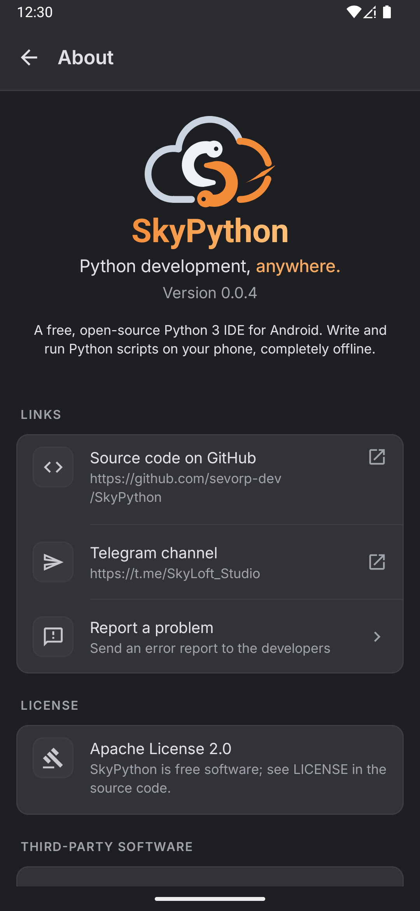
  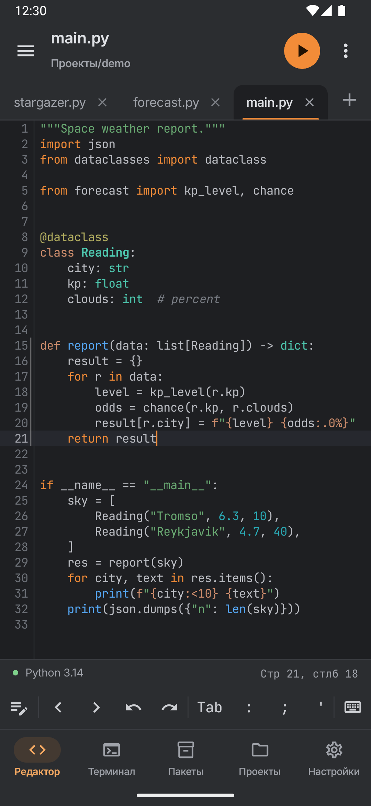
</p>
<p align="center">
  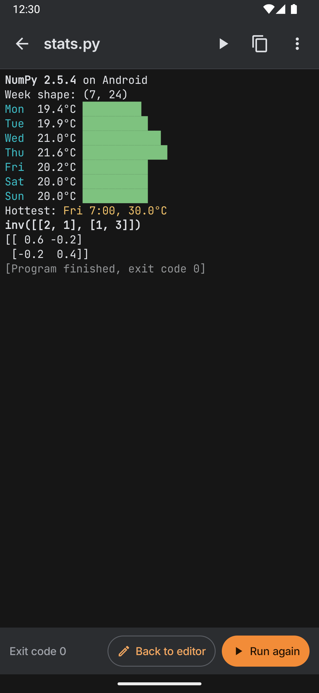
  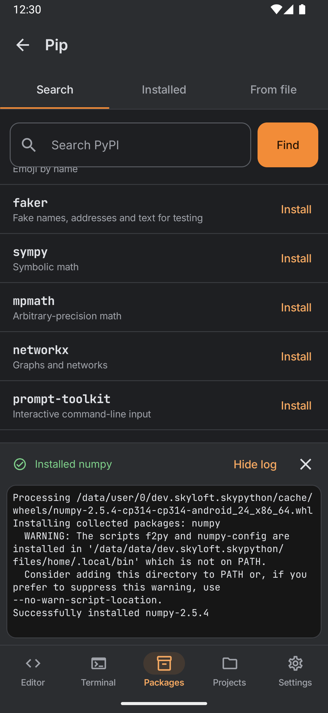
  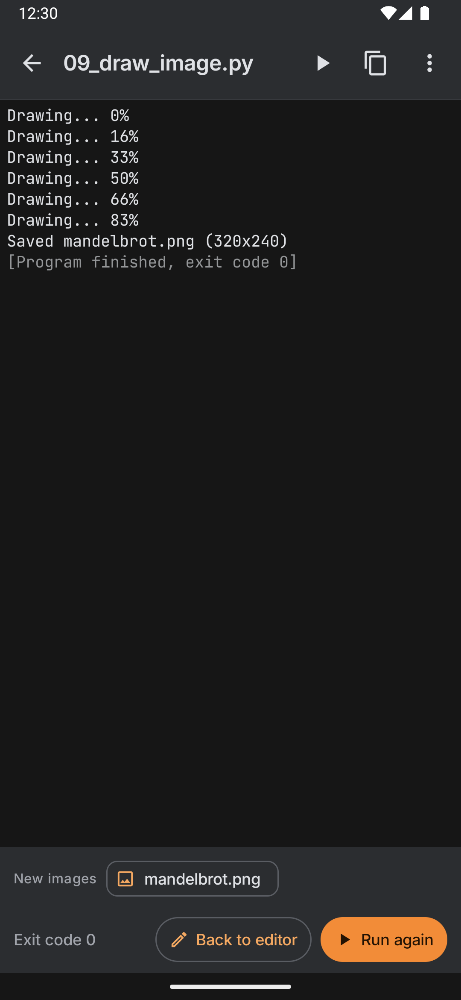
  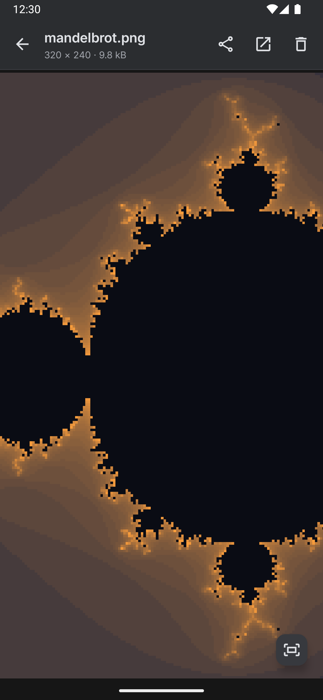
</p>

## 📥 Install

Download **one** APK from the [latest release](https://github.com/sevorp-dev/SkyPython/releases/latest)
and open it on your phone (allow *Install unknown apps* for your browser or file manager when asked).

| Your phone | File to pick | Size |
|---|---|---|
| Most phones (2017 and newer) | `SkyPython-<version>-arm64-v8a.apk` | ~15 MB |
| Old 32-bit phones | `SkyPython-<version>-armeabi-v7a.apk` | ~14 MB |
| Not sure | `SkyPython-<version>-universal.apk` — works everywhere | ~47 MB |
| Emulators, x86 Chromebooks | `SkyPython-<version>-x86_64.apk` (`-x86.apk` for 32-bit) | ~15 MB |

If Android says *"App not installed"*, you picked the wrong one — take `universal`.
`SHA256SUMS` in the release lets you verify the download. New versions install over old ones.

### Supported devices

- **Android 7.0 (API 24) and newer** — every build is tested automatically on emulators with Android 7, 9, 11, 14 and 16, including a 32-bit device.
- **64-bit ARM** (almost all phones since 2017), **32-bit ARM** (older and budget phones) and **x86 / x86_64** (emulators, Chromebooks).
- Needs about **60 MB** of free storage (the app plus Python unpacked on first run). The first Run takes a few seconds while Python is prepared; after that it starts instantly.

## 🧠 How it works

```
┌──────────────── SkyPython app (Kotlin, Jetpack Compose) ────────────────┐
│  Editor ─ Files ─ Samples ─ Settings ─ Pip ─ Console / Interpreter / Terminal │
└───────────────────────────────┬──────────────────────────────────────────┘
                                │ starts a child process, pipes stdin/stdout/stderr
                ┌───────────────▼────────────────┐
                │  libpylauncher.so (tiny C)     │  → Py_BytesMain()
                │  libpython3.14.so + stdlib     │  official CPython for Android
                │  ~/.local (pip --user packages)│
                └────────────────────────────────┘
```

- **CPython** comes from python.org's [official Android build](https://docs.python.org/3/using/android.html) (64-bit) and from our own [build workflow](.github/workflows/build-python.yml) that runs CPython's `Android/android.py` (32-bit).
- The **standard library** is packed per CPU type and unpacked once into the app's private storage.
- Each program runs as a **separate process**, exactly like on a desktop computer.
- The **editor** is [Sora Editor](https://github.com/Rosemoe/sora-editor) with TextMate grammars (MagicPython).
- **Code hints** come from a small language server in the same bundled Python: [jedi](https://github.com/davidhalter/jedi) for completions, [pyflakes](https://github.com/PyCQA/pyflakes) and `compile()` for errors. It is packed into the APK (~1 MB) and unpacked next to the stdlib, separate from your pip packages.
- **Run, Interpreter and Terminal** use a real pseudo-terminal (a tiny native `libskypty.so`) and a terminal view based on the Apache-2.0 Termux terminal emulator, so colours, line editing and Ctrl+C behave like on a computer.
- **Native packages** such as NumPy are built for Android by our [wheel workflow](.github/workflows/build-wheels.yml) (cibuildwheel) and published with checksums in the [`wheels`](https://github.com/sevorp-dev/SkyPython/tree/wheels) branch; Pip downloads the one for your phone's CPU, verifies it and installs it.
- The **debugger** is a small driver built on Python's own `bdb` module; it talks to the app over a private socket, so your program keeps its normal input and output.

## 🛠️ Build from source

1. Install [Android Studio](https://developer.android.com/studio) (bundles JDK 21) with Android SDK 36, NDK `28.2.13676358` and CMake `3.22.1` (*SDK Manager → SDK Tools*).
2. Clone and open the project:
   ```sh
   git clone https://github.com/sevorp-dev/SkyPython.git
   ```
3. Press **Run ▶** in Android Studio, or build from the command line:
   ```sh
   ./gradlew assembleDebug                                 # debug APK, all CPU types
   ./gradlew assembleRelease -Pskypython.abis=arm64-v8a    # small release APK for one CPU type
   ```

The first build downloads CPython for Android (~23 MB per CPU type), checks it against
SHA-256 hashes pinned in [`runtime/python.properties`](runtime/python.properties) and packs it
into the APK. Nothing Python-related is stored in git. Which CPU types are built is set by
`skypython.abis` in [`gradle.properties`](gradle.properties).

<details>
<summary><b>Building Python for 32-bit devices</b></summary>

python.org publishes CPython for Android only for 64-bit devices (arm64-v8a, x86_64). For older
32-bit phones (armeabi-v7a) and x86 emulators, SkyPython builds the same CPython version itself
with CPython's own `Android/android.py`:

1. Run the **Build Python for Android (32-bit)** workflow (*Actions → Run workflow*, or push the
   `build-python` branch). It takes 30–60 minutes and stores the two tarballs in the
   [`cpython-builds`](https://github.com/sevorp-dev/SkyPython/tree/cpython-builds) branch.
2. Copy the two `sha256.…=…` lines from the run summary into `runtime/python.properties`.
3. List the ABIs in `gradle.properties`: `skypython.abis=arm64-v8a,armeabi-v7a,x86,x86_64`.

The build stops with an explanation if a 32-bit ABI is enabled before its hash is pinned.
Don't re-run the workflow for an already published version: builds aren't byte-identical, so
pinned hashes would stop matching (the workflow refuses unless you tick `replace`).
</details>

### Tests

```sh
./gradlew testDebugUnitTest            # JVM unit tests
./gradlew connectedDebugAndroidTest    # on a device or emulator: runs real Python
python -m unittest discover -s runtime/src/test/python   # language server, desktop Python 3.10+
```

The language server tests use the bundle the build packs (`./gradlew :runtime:langServerBundle`).

CI ([`android.yml`](.github/workflows/android.yml)) builds every push and runs the device tests
on Android 7, 9, 11, 14 and 16. Pushing a `v*.*.*` tag publishes a release
([`release.yml`](.github/workflows/release.yml)).

### Project layout

| Path | What's inside |
|---|---|
| `app/` | The Android app: editor, console, files, pip, samples, settings (Jetpack Compose) |
| `runtime/` | Python runtime: CPython download & packaging, installer, process runner, NDK launcher |
| `buildSrc/` | Shared build logic (CPU types ↔ CPython builds) |
| `.github/workflows/` | CI, releases, 32-bit CPython builds |

## 📜 Changelog

What's new in every version: [CHANGELOG.md](CHANGELOG.md) and the [Releases](https://github.com/sevorp-dev/SkyPython/releases) page.

## 🗺️ Roadmap

- [x] Code editor with highlighting, completion and live error hints
- [x] Run scripts offline with CPython 3.14 in a real terminal
- [x] Interpreter and terminal (colours, Ctrl+C)
- [x] Pip for pure-Python packages, PyPI search
- [x] Debugger with breakpoints and watches
- [x] Go to definition, outline, find & replace
- [x] Android 7.0+ and 32-bit devices, English and Russian
- [x] Prebuilt packages with native code: **NumPy** ✅
- [x] Images your scripts save shown right in the app
- [ ] More native packages: Pillow → matplotlib → pandas
- [ ] Plots from matplotlib shown right in the app
- [ ] GUI apps (Kivy / Tkinter-style windows)
- [x] IDE dark theme
- [ ] Light theme, more languages
- [ ] OpenCV, TensorFlow Lite, PyTorch (long term)

## 🤝 Contributing

Bug reports, ideas and pull requests are welcome!

- Found a bug? [Open an issue](https://github.com/sevorp-dev/SkyPython/issues) with your Android version and phone model.
- Want a feature? Tell us in [Issues](https://github.com/sevorp-dev/SkyPython/issues) or on [Telegram](https://t.me/SkyLoft_Studio).
- Sending code? Please open an issue first for bigger changes, and run `./gradlew testDebugUnitTest` before the PR.

## 👨‍💻 Author

Developed by **[Sevorp](https://github.com/sevorp-dev)** · **SkyLoft Studio 🌥**

- Telegram (author): [@Sevorp](https://t.me/Sevorp)
- Telegram channel: [@SkyLoft_Studio](https://t.me/SkyLoft_Studio)
- GitHub: [sevorp-dev](https://github.com/sevorp-dev)

## 📄 License

SkyPython is licensed under the [Apache License 2.0](LICENSE).

It bundles: **CPython** (PSF License), **Sora Editor** (LGPL-2.1), **MagicPython grammar** and
**VS Code theme data** (MIT) — see [`NOTICE.md`](app/src/main/assets/textmate/NOTICE.md) — and the
**Inter** and **JetBrains Mono** fonts (SIL Open Font License 1.1), the **Termux terminal emulator**
(Apache-2.0, see [`terminal/NOTICE`](terminal/NOTICE)) and **jedi**, **parso**, **pyflakes** (MIT) with
**typeshed** stubs (Apache-2.0) — see [`NOTICE`](NOTICE).
SkyPython is an independent project and is not affiliated with the Python Software Foundation.

---

<div align="center">
  <strong>SkyPython</strong> — Python development, anywhere. ☁️<br>
  <sub>Made with ❤️ by SkyLoft Studio</sub>
</div>
